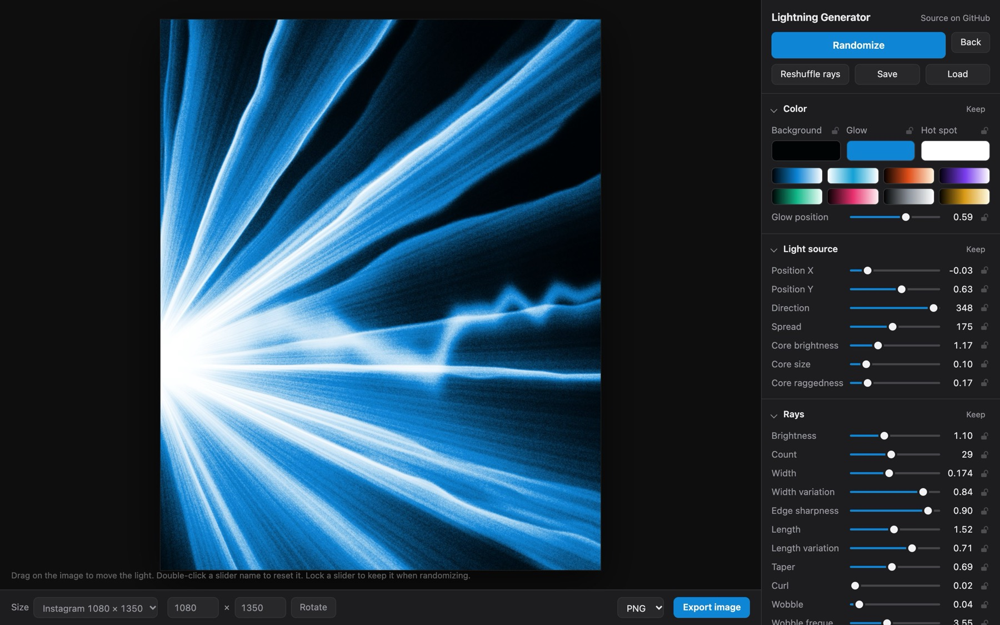
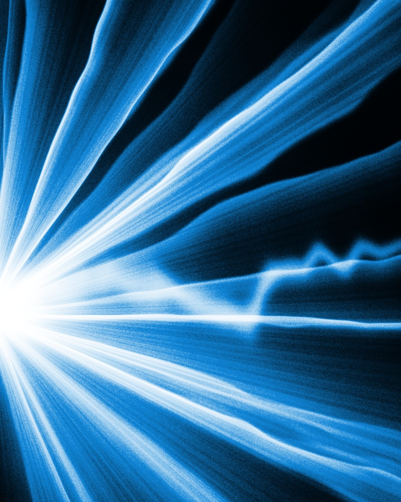
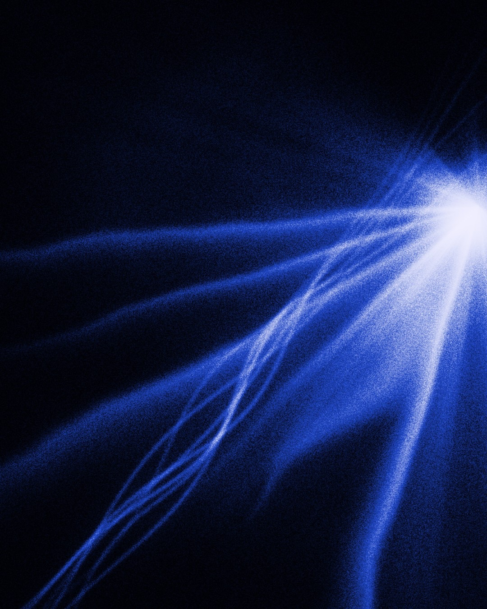
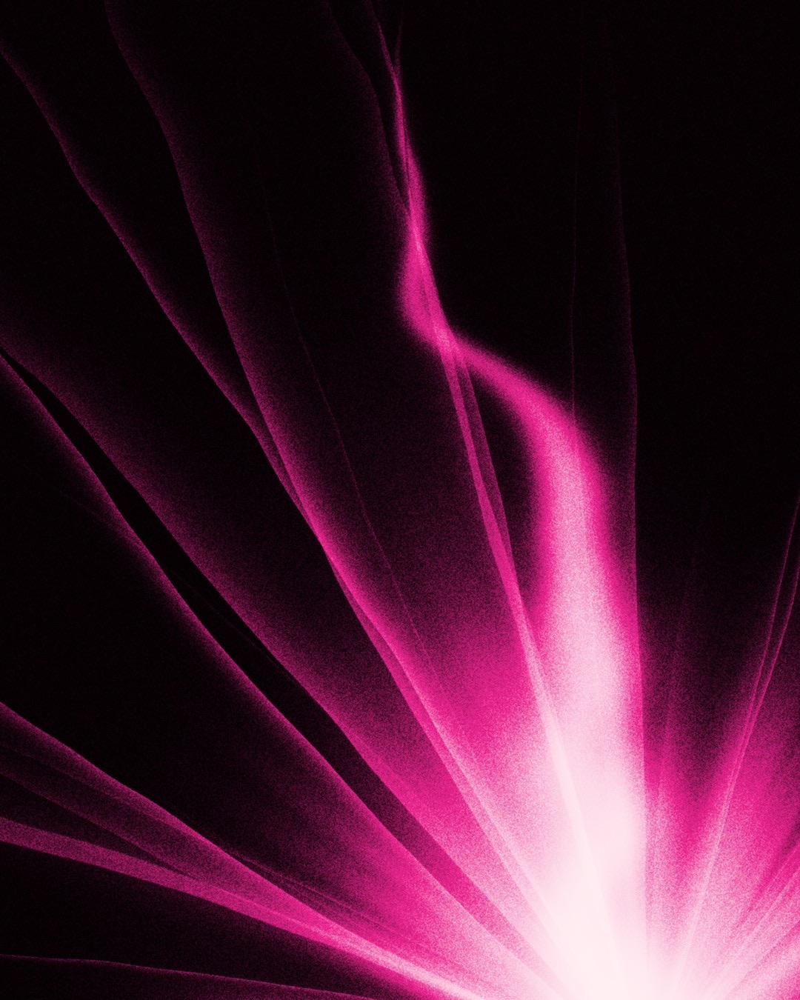
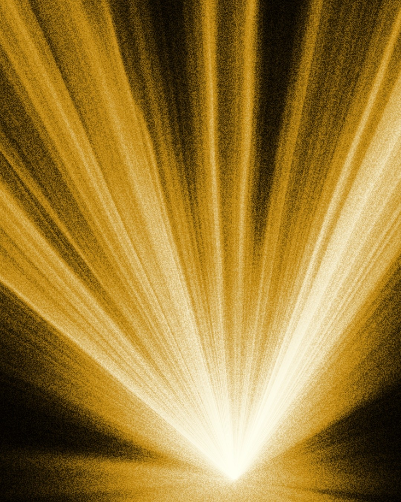
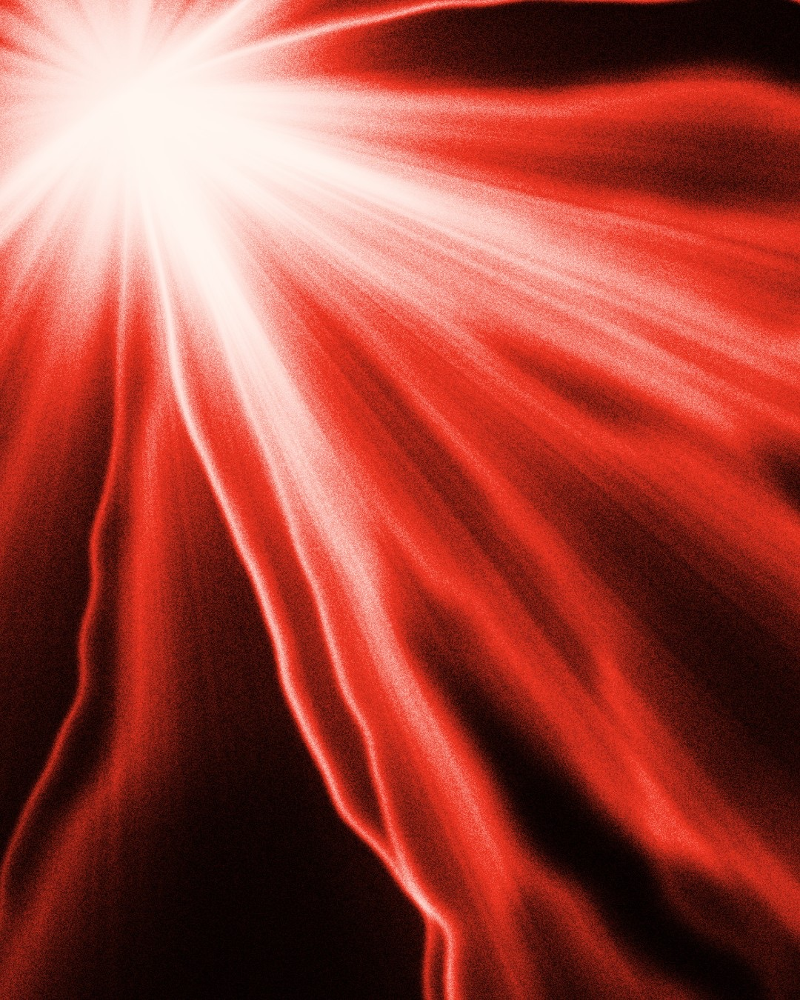
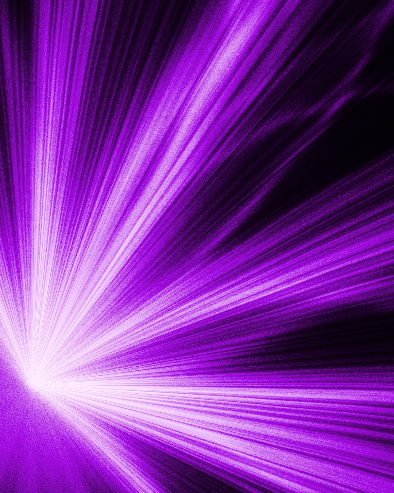
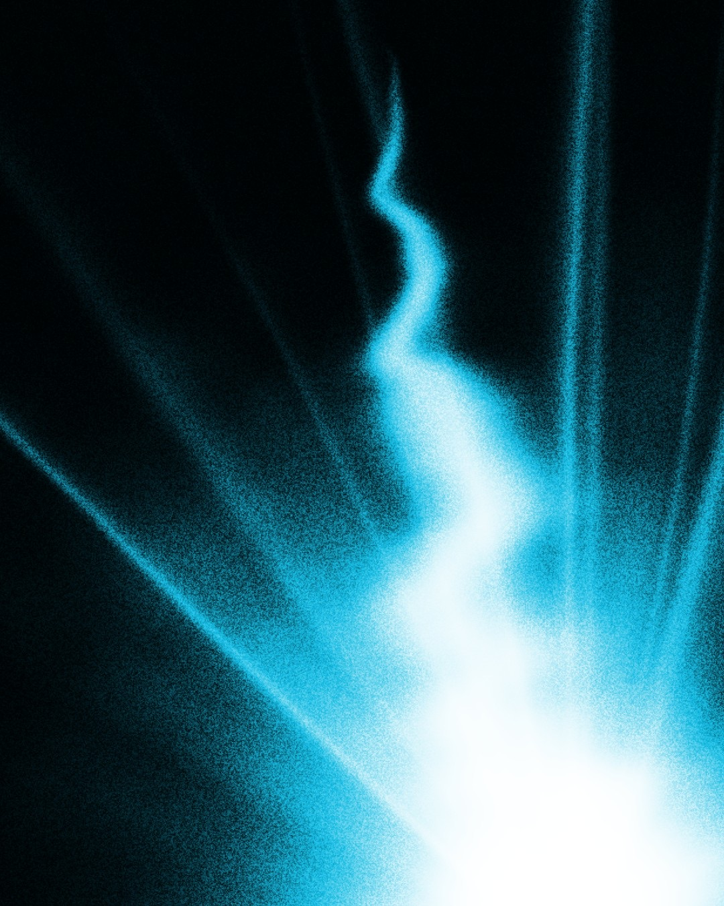
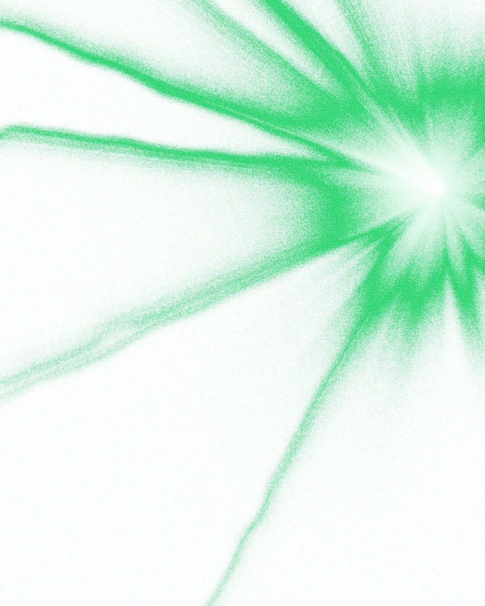

<h1 align="center">⚡ Lightning Generator</h1>

<p align="center">
  Glowing light-ray, comet and lightning visuals, generated in your browser.<br>
  Dozens of sliders, one-click randomize, export up to 16K. Free and open source.
</p>

<p align="center">
  <a href="https://lightning-generator.vercel.app"><b>→ Try it free in your browser</b></a>
</p>

<p align="center">
  
</p>

## What it makes

Every image below came straight out of the generator with one press of **Randomize**. No editing.

<table>
  <tr>
    <td></td>
    <td></td>
    <td></td>
    <td></td>
  </tr>
  <tr>
    <td></td>
    <td></td>
    <td></td>
    <td></td>
  </tr>
</table>

To start from one of these looks, open the app, click **Load** and pick the matching file in [`examples/presets`](examples/presets).

## Features

- **Randomize** builds a new composition: it places the light, aims it into the frame and picks colors that work together.
- **Keep and lock.** Keep a whole section (for example Color), or lock single sliders. Randomize then changes only the rest.
- **More than 40 settings** in 7 groups: light source, rays, thin streaks, haze, plume, filaments, and finish (exposure, contrast, vignette, film grain).
- **Drag on the image** to move the light source.
- **8 color palettes**, or pick your own background, glow and hot-spot colors.
- **Export PNG or JPEG at any size up to 16384 px.** Presets include Story, Instagram, 4K, phone wallpaper and a 6000 × 9000 poster. Big images are rendered in tiles, so they don't hit the GPU's size limit.
- **Save and Load** settings as small JSON files, so you can share a look or come back to it later.
- **Back** undoes up to 60 steps. Your current look is remembered between visits.

### Shortcuts

| Key | Action |
| --- | --- |
| `R` | Randomize |
| `S` | Reshuffle the rays, keep every setting |
| `Z` | Back to the previous look |
| Double-click a slider name | Reset that slider |

## Run it locally

It's one HTML file with no dependencies and no build step.

```bash
git clone https://github.com/matthewboff/lightning-generator.git
open lightning-generator/index.html   # or just double-click it
```

You need a browser with WebGL 2: any current Chrome, Edge, Safari or Firefox.

## How it works

The whole image is drawn by a single WebGL 2 fragment shader, inside [`index.html`](index.html):

- Each **ray** is a wedge with one hard edge and one long soft falloff, like a caustic fold. Its width, length, curl and wobble come from a seeded hash, so the same seed always gives the same image.
- **Haze**, the **core**, the **plume** and the **filaments** are separate light layers. They are added together, tone-mapped, and contrast-shaped.
- **Film grain** goes onto the light before coloring, so it picks up the glow color the way grain does in real photos.
- The final light value maps onto a three-color gradient: background → glow → hot spot.

Each slider becomes a `u_<name>` uniform. To add a new setting, add one line to the `GROUPS` table and use the uniform in the shader. The UI builds itself from that table.

## Contributing

Issues and pull requests are welcome, especially new layers, new palettes, or presets you're proud of. Put presets in `examples/presets` with a preview image.

## License

[MIT](LICENSE). Use the generator and anything you make with it however you like, including commercial work.
